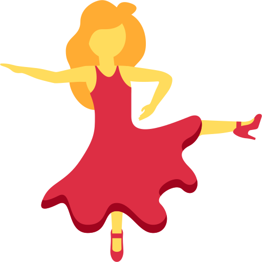

  
  

    
enbu

    
チームの機密情報を、仕組みで安全に

    
github.com/enbu-net/enbu

  

<!--
enbu という、チームで機密情報を共有する道具の話をします
-->

---
title: §1 シークレットの話
est: 0:04
---

<EnbuSection :n="1" />

<!--
まず、機密情報の話
-->

---
title: シークレットってなに?
est: 0:18
---

<EnbuStage :zoom="1.2">

機密情報 = = 1 }">知られたら困るもの

  

🔑

API キー

使い放題にされる

  

🗝️

パスワード

DB を丸ごと

  

⚙️

設定ファイル

.env など

  

📄

機密文書

顧客情報など

  
😈 コピーされたら、他人でもそのまま使える。漏れた事実は取り消せない

</EnbuStage>

<!--
API キーやパスワード、設定ファイル、顧客情報。知られたら困るものを、誰もが扱っています
[click:1] コピーされたら他人がそのまま使えて、漏れたら取り消せません
-->

---
title: でも見せないと開発できない
est: 0:11
---

<EnbuStage :zoom="1.2">

本来は誰にも見せてはダメ。 でも、仲間には見せないと開発できない

  <svg width="520" height="210" viewBox="0 0 520 210">
    <circle cx="260" cy="105" r="95" fill="#fff1f2" stroke="#dd2e44" stroke-width="3" stroke-dasharray="8 6" />
  </svg>
  

    

      
🔑

      
🧑‍💻👩‍💻🧑‍🎓

    

  

  
😈

  
🕵️

</EnbuStage>

<!--
だから本来は、誰にも見せてはいけない
[click:1] でも仲間には見せないと、開発が進みません
-->

---
title: そもそも矛盾している
est: 0:08
---

<EnbuStage :zoom="1.3">

「見せてはいけないものを、 限られた人にだけ見せたい」そもそも矛盾した話。だから、みんなどこかで無理をしている

  <EnbuBox icon="🙈" title="見せない" tone="accent" class="w-32" />
  
⇄

  <EnbuBox icon="👀" title="見せる" tone="accent" class="w-32" />

</EnbuStage>

<!--
見せてはいけないものを、限られた人にだけ見せる。そもそも矛盾した話です
-->

---
title: §2 今のやり方
est: 0:04
---

<EnbuSection :n="2" />

<!--
では今、どうしているか
-->

---
title: チャットで送る
est: 0:27
---

<EnbuStage :zoom="1.15">

チャットに貼ると、= 2 }">ずっと残る

  

    
# dev-team🔍 API_KEY <b>1 件</b>

    
2025 年 4 月 1 日

    
= 2 }"><b>Alice</b>本番のキーです<code>API_KEY=sk-live-9x2fQ7</code>

    
<b>Bob</b>顧客リストも置いときます📎 顧客リスト.xlsx

    
— 1 年後 —

    
➕ Carol が参加しました

  

  

    
2.4%

    
企業の Slack チャンネルの 2.4% に、シークレットが残っていた

    
GitGuardian「State of Secrets Sprawl 2025」

  

</EnbuStage>

<!--
一番多いのは、Slack や Discord に貼る方法
[click:1] 1 年後、新しく Carol が入ってきて
[click:2] 検索すると、昔のキーがそのまま出てきます
[click:3] 企業の Slack の 2.4% のチャンネルに、実際に残っていたそうです
-->

---
title: チャットは値が化ける
est: 0:18
---

<EnbuStage :zoom="1.12">

貼った値は、= 1 }">化けるし、= 2 }">古くなる

  

    
# dev

    
送ったテキスト<code>DB_PASSWORD=pa__ss__word</code>

    
<b>Alice</b>DB_PASSWORD=pa<u>ss</u>word

    
<b>Bob</b>コピーしたけど password で入れない…

  

  

    
# dev

    
<b>Alice</b>API_KEY=sk-live-<s>9x2f</s>

    
<b>Alice</b>キー変えました sk-live-<s>Q7mk</s>

    
<b>Alice</b>すみません、こっちが最新 sk-live-Zp4c

    
<b>Bob</b>まだ 1 個目のを使ってた…

  

</EnbuStage>

<!--
Discord では、アンダースコア 2 つで囲むと下線になります
[click:1] コピーすると記号が消えて、動きません
[click:2] 値を変えるたびに貼り直しで、古い値を使う人が出ます
-->

---
title: SOPS ですり替え
est: 0:32
---

<EnbuStage :zoom="1.15">

Git で暗号化しても、= 2 }">中身をすり替えられるSOPS:値を暗号化して  Git にコミットする道具

  

    
<i /><i /><i />

    
# 😈 Mallory: 書き込めるだけ。鍵はない

    
$ cat .sops.yaml

    
  - age: age1w39g…, age1a4ft… # 公開鍵は丸見え

    
$ echo 'API_URL=https://evil.example' \

    
&nbsp;&nbsp;| sops encrypt … > .env.enc

    
$ git commit -am "update secrets"

    
# 🧑‍💻 Alice

    
$ sops decrypt .env.enc

    
API_URL=https://evil.example

    
# エラーも警告も出ない

  

  

    
🔒 ≠ ㊞

    
暗号化は「読めなくする」だけ。<b>誰が書いたか</b>は確かめない

  

</EnbuStage>

<!--
次は、SOPS で暗号化して Git に置く方法。実際に試しました。Mallory は鍵がなく、書き込めるだけ
[click:1] 宛先の公開鍵で、自分の値を暗号化してコミット
[click:2] Alice が開くと、警告なしに偽の値が出てきます
[click:3] 暗号化は読めなくするだけで、誰が書いたかは確かめません
-->

---
title: SOPS は手作業が多い
est: 0:16
---

<EnbuStage :zoom="1.12">

メンバーが変わるたびに、= 2 }">全部手作業

  

    
👋 1 人入る・抜けるたびに

    
① 公開鍵を集める(チャットで…)

    
② .sops.yaml を書き換える

    
③ 全部のファイルで <code>sops updatekeys</code>

    
④ 抜けた人が見た値を全部変える

    
⑤ コミットして、全員に pull してもらう

  

  

    
<i /><i /><i />

    
# 2 人が別々に値を変えた

    
$ git merge bob

    
CONFLICT … in .env.enc

    
# 暗号文を手で直す

  

</EnbuStage>

<!--
人が出入りするたびに、鍵を集めて暗号化し直し
[click:1] 2 人が別々の値を変えただけで、暗号文がコンフリクトします
[click:2] 全部、手作業です
-->

---
title: 専用サービス
est: 0:19
---

<EnbuStage :zoom="1.1">

専用サービスは安全。でも、= 2 }">人数分のお金がかかる

  

    
🧾 5 人で 1 年使うと(1 ドル = 150 円)

    
1Password Teams<small>10 人まで定額</small><b>約 4.5 万円</b>

    
1Password Business<small>1 人 $8.99/月</small><b>約 8.1 万円</b>

    
Doppler Team<small>1 人 $21/月</small><b>約 19 万円</b>

    
2026 年 11 月、各社公式サイトの価格

  

  

    
🤝 社外の人を 1 人足すと <b>+1.6 万〜3.8 万円/年</b>

    
🎓 学生 5 人なら <b>1 人 9 千〜3.8 万円/年</b>

  

</EnbuStage>

<!--
1Password のような専用サービスは安全ですが、5 人で年に 4 万から 19 万円
[click:1] 社外の人を足すと、さらに増えます
[click:2] 学生チームには重いですね
-->

---
title: 今のやり方のまとめ
est: 0:18
---

<EnbuStage :zoom="1.15">

安全と手軽さが、= 1 }">両立していない

<table class="cmp">
  <thead><tr><th></th><th>抜けた人に 見えない</th><th>すり替え られない</th><th>手間が 少ない</th><th>無料・ アカウント不要</th></tr></thead>
  <tbody>
    <tr><td> チャット</td><td class="ng">✗</td><td class="ng">✗</td><td class="ng">✗ 貼り直し</td><td class="ok">○</td></tr>
    <tr><td> SOPS + Git</td><td class="ng">△ 手作業</td><td class="ng">✗</td><td class="ng">✗</td><td class="ok">○</td></tr>
    <tr><td> 専用サービス</td><td class="ok">○</td><td class="ok">○</td><td class="ok">○</td><td class="ng">✗</td></tr>
    <tr v-click="2" class="want"><td>💃 ほしいもの</td><td class="ok">○</td><td class="ok">○</td><td class="ok">○</td><td class="ok">○</td></tr>
  </tbody>
</table>

</EnbuStage>

<!--
どれも、どこかに丸がつきません
[click:1] 安全と手軽さが両立せず、人の注意と手作業に頼っています
[click:2] 手軽で、安全で、安いもの。それを作りました
-->

---
title: §3 enbu
est: 0:03
---

<EnbuSection :n="3" />

<!--
それが enbu です
-->

---
title: enbu とは
est: 0:19
---

<EnbuStage :zoom="1.15">

今あるアカウントと置き場所で、 = 1 }">機密情報を安全に保管・共有

  
  

    
👤 アカウントを増やさない。 GitHub や S3 をそのまま使う

    
🔑 鍵の手動管理なし

    
🧰 暗号化・履歴・共有・取得を 1 つの仕組みで

    
🖥️ GUI(デスクトップ / VS Code)と CLI

    
🛡️ 目指すのは Secure by Default:人の注意や手作業に頼らない

  

</EnbuStage>

<!--
今ある GitHub や S3 を使って、アカウントも鍵の手作業も増やさず、暗号化から共有までをまとめて扱います
[click:1] 目指すのは、人の注意に頼らない Secure by Default です
-->

---
title: enbu のやり方
est: 0:16
---

<EnbuStage :zoom="1.15">

今ある置き場所に、= 1 }">鍵をかけた中身だけを置く

  

    <EnbuBox icon="🧑‍💻" title="Alice" sub="🔑 Alice の鍵" class="w-40 py-1" />
    <EnbuBox icon="👩‍💻" title="Bob" sub="🔑 Bob の鍵" class="w-40 py-1" />
  

  <EnbuArrow v-click="1" label="🔒 暗号文" flow color="#dd2e44" size="6rem" />
  

    
☁️ 今ある置き場所

    

      <EnbuBox icon="📦" title="GitHub" class="w-24 py-1" />
      <EnbuBox icon="🪣" title="S3" class="w-24 py-1" />
    

  

  💸 追加のお金 <b class="ng-mark">なし</b>
  👤 新しいアカウント <b class="ng-mark">なし</b>

</EnbuStage>

<!--
1 人 1 つずつ鍵を持ち
[click:1] 全員の鍵で開けられる暗号文だけを、置き場所に置きます
[click:2] だから追加のお金もアカウントもいりません
-->

---
title: §4 だれに嬉しい?
est: 0:03
---

<EnbuSection :n="4" />

<!--
だれに嬉しいか
-->

---
title: 個人開発者
est: 0:22
---

<EnbuStage :zoom="1.15">

🧑‍💻 個人開発者・初学者:= 1 }">消しても戻せる、漏らさない

  

😩 今

.env は今の PC の中だけ

消したら作り直し

うっかり Git にコミット

  

✅ enbu だと

消してもクラウドから戻せる

履歴が自動で残る

.gitignore も自動で、うっかり公開を防ぐ

GUI で簡単。CLI なら AI も使える

  

⚠️ 困るところ

合鍵がない。<b>全部の PC を失うと開けない</b>

→ 2 台以上登録しておく

</EnbuStage>

<!--
個人開発者や初学者は、.env を消したり、うっかりコミットしたり
[click:1] enbu なら、クラウドから戻せて履歴も残り、.gitignore も自動です
[click:2] ただ合鍵はないので、PC は 2 台以上登録してください
-->

---
title: 学生チーム
est: 0:21
---

<EnbuStage :zoom="1.15">

🎓 学生チーム:= 1 }">無料で、いつも最新

  

😩 今

Slack や Discord に貼る

どれが最新か分からない

卒業生もずっと読める

  

✅ enbu だと

貼らずに、安全に手軽に共有

enbu が唯一の正 → 迷わない

無料で使える

卒業したら外せる

  

⚠️ 困るところ

全員がアプリを入れる

管理者が 1 台ずつ承認

外したら、値は自分で変える

</EnbuStage>

<!--
学生チームは、チャットに貼って、どれが最新か分かりません
[click:1] enbu が唯一の正しい値になり、無料で、卒業したら外せます
[click:2] ただ全員がアプリを入れて、1 台ずつ承認が要ります
-->

---
title: 企業
est: 0:21
---

<EnbuStage :zoom="1.15">

🏢 企業:= 1 }">今の基盤のまま、社外の人とも

  

😩 今

社外の人にも席を買う

zip + パスワード別送

終わっても外し忘れる

  

✅ enbu だと

今のアカウント基盤で導入

社外とのやり取りや、クラウドストレージの代わりに

委託やインターンも、承認して終わったら外す

  

⚠️ 困るところ

SSO や細かい権限はまだない

CI が自動で読めない

誰が読んだかは記録できない

</EnbuStage>

<!--
企業は、社外の人に席を買うか、zip とパスワード別送
[click:1] enbu なら今の基盤のまま、承認して、終わったら外すだけ
[click:2] ただ SSO はなく、誰が読んだかの記録も取れません
-->

---
title: §5 デモ
est: 0:03
---

<EnbuSection :n="5" />

<!--
では、動かしてみます
-->

---
title: デモ
est: 1:09
voiceHold: true
---

<EnbuStage :zoom="1.2">

Alice から Bob に、.env を渡します 🎬1 台の PC で、デバイスも GitHub アカウントも別の 2 人

  <EnbuBox icon="🧑‍💻" title="Alice" sub="管理者" tone="accent" class="w-32" />
  

    
① Alice が値を入れる

    
② Bob が参加 → 指紋を確認して承認

    
③ Alice が値を変える

  

  <EnbuBox icon="👩‍💻" title="Bob" sub="新メンバー" class="w-32" />

👀 見てほしいところ:<b>チャットに 1 回も貼らない</b>/<b>値を変えても、貼り直さない</b>

</EnbuStage>

<!--
Alice が Bob に .env を渡します。見てほしいのは、一度も貼らず、変えても貼り直さないところです
-->

---
title: いま見たこと
est: 0:13
---

<EnbuStage :zoom="1.15">

いま見たのは、= 1 }">貼らない・貼り直さない共有

<table class="seen">
  <tbody>
    <tr><td>💬 チャットに貼らずに渡せた</td><td>→ 残らない・化けない</td></tr>
    <tr><td>🔄 値を変えたら同期するだけ</td><td>→ 古い値を使わない</td></tr>
    <tr><td>👤 GitHub アカウントだけ</td><td>→ お金もアカウントも増えない</td></tr>
    <tr><td>🔍 指紋を確かめて承認</td><td>→ 偽物のメンバーを入れない</td></tr>
  </tbody>
</table>

</EnbuStage>

<!--
貼らずに渡せて、変えても同期だけ。アカウントも増えません
[click:1] 人が確かめるのは、承認する時の指紋だけです
-->

---
title: §6 デモの裏側
est: 0:03
---

<EnbuSection :n="6" />

<!--
その裏側です
-->

---
title: 置き場所は信用しない
est: 0:09
---

<EnbuStage :zoom="1.25">

置き場所は、= 1 }">信用しない見えるのは暗号文とハンコだけ

  

    
🏠 自分の PC

    
🔑 🔓

    
開けるのはここだけ

  

  

    <EnbuArrow label="🔒 + ㊞" flow color="#dd2e44" size="6rem" />
  

  

    
☁️ 置き場所

    
🔒 🔒 🔒

    
中身は読めない

  

</EnbuStage>

<!--
置き場所に送るのは、暗号文とハンコだけ
[click:1] 置き場所そのものは、信用しません
-->

---
title: メンバー表にはハンコ
est: 0:18
---

<EnbuStage :zoom="1.25">

メンバー表には、= 2 }">管理者のハンコハンコ = 電子署名。本人にしか押せない

  

👑 Alice

㊞

  <EnbuArrow v-click="1" label="Alice が押す" color="#16a34a" size="4.5rem" />
  

👑 Alice

👩‍💻 Bob

㊞

  <EnbuArrow v-click="2" label="Alice が押す" color="#16a34a" size="4.5rem" />
  

👑 Alice

👩‍💻 Bob

🧑‍🎓 Carol

㊞

</EnbuStage>

<!--
メンバー表には、管理者のハンコ、電子署名が押されています
[click:1] さっきの承認は、ハンコを押した新しい表を作ること
[click:2] 暗号化の宛先は、この表からしか作りません
-->

---
title: §7 攻撃にどう耐えるか
est: 0:04
---

<EnbuSection :n="7" />

<!--
攻撃する側から見てみます
-->

---
title: 偽物は無視
est: 0:13
---

<EnbuStage :zoom="1.3">

偽物を置かれても、= 1 }">ハンコがないので無視

  

👑 Alice

👩‍💻 Bob

㊞

  
= 1 }">
😈 Mallory

「私もメンバー」

  
✗ 無視

</EnbuStage>

<!--
SOPS ではすり替えが通りました。enbu で Mallory が偽物を置くと
[click:1] ハンコがないので、無視されます
-->

---
title: 巻き戻しに気づく
est: 0:08
---

<EnbuStage :zoom="1.3">

古い版に戻されても、= 1 }">気づいて止まる

  
v1

  
v2

  
v3
📌 手元の記録

  
😈 置き場所を v1 に

  <EnbuArrow color="#dc2626" size="3rem" />
  
⛔ v3 より古い → 止める

</EnbuStage>

<!--
古い版に戻す攻撃は
[click:1] 手元の記録より古ければ止まります
-->

---
title: 守れないもの
est: 0:13
---

<EnbuStage :zoom="1.15">

メンバー本人が裏切ったら、= 1 }">止められない内部の攻撃者や、乗っ取られたメンバーの PC

  <EnbuBox icon="👩‍💻" title="Bob(メンバー)" sub="正しく復号できる" class="w-48" />
  <EnbuArrow label="値をコピー" color="#b91c1c" size="5rem" />
  <EnbuBox icon="😈" title="外へ持ち出す" tone="bad" class="w-44" />

  
<b class="ok-mark">できること</b> 外す・値を変える・承認の記録

  
<b class="ng-mark">できないこと</b> 持ち出しを防ぐ・誰が読んだか知る

</EnbuStage>

<!--
ただ、読めるメンバー本人が裏切ったら
[click:1] 持ち出しは止められません
[click:2] できるのは、外して、値を変えるところまでです
-->

---
title: §8 作るときの工夫
est: 0:03
---

<EnbuSection :n="8" />

<!--
作るときの工夫
-->

---
title: 工夫は 3 つ
est: 0:03
---

<EnbuStage :zoom="1.25">

工夫したのは 3 つ

  

㊞

① 署名付きの状態管理

  

🔀

② 共同編集の競合処理

  

🔑

③ 秘密鍵の安全な運用

</EnbuStage>

<!--
工夫は 3 つです
-->

---
title: すべての版にハンコ
est: 0:14
---

<EnbuStage :zoom="1.2">

① すべての版に、= 1 }">書いた人のハンコ

  
v1
🧑‍💻 Alice ㊞

  
v2
👩‍💻 Bob ㊞

  
v3
🧑‍💻 Alice ㊞

前の版も署名に含める → <b>偽物・差し替え・巻き戻し</b>が分かる

</EnbuStage>

<!--
1 つ目。値の版にも全部、書いた人のハンコを押して、前の版とつなげます
[click:1] だから偽物や巻き戻しが分かります
-->

---
title: enbu は分散システム
est: 0:18
---

<EnbuStage :zoom="1.15">

② enbu には、= 1 }">順番を決めるサーバーがない

  

    
☁️ 専用サービス

    

      
🧑‍💻

👩‍💻

🧑‍🎓

      
🖥️ サーバーが 順番を決める

    

  

  

    
💃 enbu

    

      
🧑‍💻

👩‍💻

🧑‍🎓

      
📦 置くだけ (信用しない)

    

  

各 PC が、自分で正しいかを判断する = <b>分散システム</b>

</EnbuStage>

<!--
2 つ目は競合。専用サービスでは、サーバーが順番を決めます
[click:1] enbu の置き場所は、置くだけ
[click:2] 各 PC が自分で判断する、分散システムです
-->

---
title: 同時に書いても消えない
est: 0:14
---

<EnbuStage :zoom="1.15">

2 人が同時に書いても、= 2 }">消えない

  <svg class="absolute inset-0 w-full h-full" viewBox="0 0 760 240">
    <path v-click="1" d="M140,120 C200,120 210,50 270,50" stroke="#6b7280" stroke-width="3" fill="none" />
    <path v-click="1" d="M140,120 C200,120 210,190 270,190" stroke="#6b7280" stroke-width="3" fill="none" />
    <path v-click="2" d="M440,50 C500,50 510,120 570,120" stroke="#6b7280" stroke-width="3" fill="none" />
    <path v-click="2" d="M440,190 C500,190 510,120 570,120" stroke="#6b7280" stroke-width="3" fill="none" />
  </svg>
  
A=1 B=1

  
🧑‍💻 <b>A=2</b> B=1

  
👩‍💻 A=1 <b>B=2</b>

  
✓ <b>A=2 B=2</b>

</EnbuStage>

<!--
2 人が同時に書いても
[click:1] 上書きせず両方残し
[click:2] 自動で合わせます。同じ所なら人に選んでもらいます
-->

---
title: まれな順番だけ壊れる
est: 0:13
---

<EnbuStage :zoom="1.15">

壊れるのは、= 1 }">まれな順番のときだけ

  

    

      = 1, tried: [1, 2, 3].includes(i) }" />
    

    
書く・読む・承認・通信切れ…の並び方

  

  

    
 手で試せるのは数通り

    
 バグはここだけ

  

🧪 だから、並び方ごと機械に試させる → <b>DST</b>

</EnbuStage>

<!--
出来事の並び方は、ものすごい数
[click:1] バグはまれな並び方でだけ出ます
[click:2] そこで DST です
-->

---
title: DST とは
est: 0:16
---

<EnbuStage :zoom="1.2">

DST = = 1 }">仮想の世界で何千回もリハーサル

  

    
🌐 仮想の世界

    

      
🧩 enbu 本体

      
🔒 暗号

    

    

      
☁️ 置き場所

      
⏰ 時計

      
💻 PC

    

    

      本物作り物
    

  

</EnbuStage>

<!--
DST は、決定的シミュレーションテスト
[click:1] 本体と暗号は本物、置き場所と時計と PC は作り物の世界で、何千回も動かします
-->

---
title: 失敗を再現できる
est: 0:16
---

<EnbuStage :zoom="1.25">

同じサイコロなら、= 1 }">同じ失敗をもう一度

  
🎲 seed 42

  <EnbuArrow size="3rem" />
  
🧑‍💻 書く → 📡 通信が落ちる → 👩‍💻 読む → 💥

  
🎲 seed 42

  <EnbuArrow size="3rem" />
  
🧑‍💻 書く → 📡 通信が落ちる → 👩‍💻 読む → 💥

🌙 毎晩 <b>1,024 通り × 5 OS</b>

</EnbuStage>

<!--
並び方はサイコロで決めます
[click:1] 同じ目なら、同じ失敗をもう一度起こせます
[click:2] 毎晩 1,024 通りを、5 つの OS で回しています
-->

---
title: 鍵は PC から出ない
est: 0:14
---

<EnbuStage :zoom="1.3">

③ 鍵は 1 人 1 つ。= 1 }">PC から出ないチップ(TPM など)に鍵を作った場合。そうでなければ OS の鍵の保管庫へ

  

    
💻 PC

    

      
セキュリティチップ

      
🔑

    

  

  

    <EnbuArrow label="ディスクを丸ごとコピー" color="#dc2626" size="7rem" />
    

      
😈 コピー

      

∅

    

  

</EnbuStage>

<!--
3 つ目は秘密鍵。鍵は PC のセキュリティチップの中で作ります
[click:1] ディスクを丸ごとコピーされても、鍵はついていきません
-->

---
title: §9 これから
est: 0:02
---

<EnbuSection :n="9" />

<!--
これから
-->

---
title: これから
est: 0:21
---

<EnbuStage :zoom="1.25">

目指すのは、= 2 }">気をつけなくても漏れない世界

  <EnbuBox icon="💃" title="今回" sub=".env をチームで共有" tone="accent" class="w-40" />
  <EnbuArrow v-click="1" size="2.5rem" />
  

    
⏳ 使う時だけ有効

    
🕵️ 怪しい動きを見つける

    
🚨 漏えいスキャン

  

  <EnbuArrow v-click="2" size="2.5rem" />
  <EnbuBox v-click="2" icon="🌏" title="夢" sub="文書や顧客情報も、だれでも" class="w-40" />

</EnbuStage>

<!--
今回作ったのは、チームで .env を共有するところまで
[click:1] 次は、使う時だけ有効な鍵や、怪しい動きの検知
[click:2] 夢は、どんな機密情報も、気をつけずに扱える世界です
-->

---
title: まとめ
est: 0:11
---

  
  

    
見せてはいけないものを、 仕組みで、限られた人にだけ

    
github.com/enbu-net/enbu

  

<!--
見せてはいけないものを、仕組みで、限られた人にだけ。それが enbu です。ありがとうございました
-->
